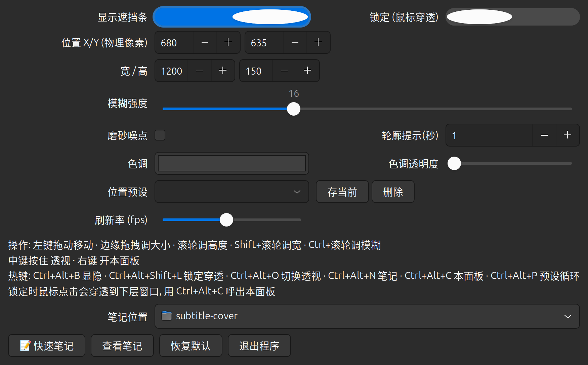

# Subtitle Cover 字幕遮挡条

**A frosted-glass bar that sits above everything (fullscreen included) to hide
your native-language subtitle line — so you can actually learn from
dual-subtitle videos.**

Watch videos with dual subtitles (e.g. English + your native language) and
cover the native line with a real-time frosted-glass bar. System-level
always-on-top (even above fullscreen video), real-time Gaussian blur,
pure Linux + X11.

[中文说明](README.zh-CN.md)


## Why this exists

Reading the native line ruins the listening practice. Browser extensions only
work inside the browser, and there was **no Linux desktop tool** for this —
the existing ones ([oh-subtitle][ohs], [subtitle-hider][sh]) are Windows-only.
This fills that gap.

[ohs]: https://github.com/Surbowl/oh-subtitle
[sh]: https://github.com/Bennycopter/subtitle-hider

## Features

- **Always on top — fullscreen included**: an `override_redirect` X11 window
  above every normal window, including fullscreen players and browsers.
- **Real-time frosted blur**: continuously blurs whatever is actually beneath
  it; changes follow within one frame (~66 ms at 15 fps). Adjustable blur
  strength, tint color/opacity and frost-noise texture.
- **Peek**: hold the middle mouse button and the bar vanishes instantly
  (unmapped — zero latency); release to bring it back. `Ctrl+Alt+O` toggles
  the same peek state from the keyboard.
- **Outline hint**: whenever the bar (re)appears or jumps to a preset, a
  marching-ants outline flashes around it for a few seconds — no more losing
  track of it on flat-colored backgrounds.
- **Air wall**: the bar can never be dragged/resized/wheeled off-screen; it
  stops flush at every screen edge (off-screen coordinates from old configs
  self-heal on startup).
- **Drag handles**: grab any edge/corner to resize, drag the middle to move.
  While dragging/resizing the bar switches to a **solid color + outline**
  (live blur paused) so you never see laggy delayed content — the frosted
  blur resumes the moment you release. Wheel works too: height /
  `Shift`+wheel width / `Ctrl`+wheel blur.
- **Quick notes**: `Ctrl+Alt+N` pops a sticky note; each note can attach a
  screenshot of what was on screen. Saved as Markdown in
  `~/.local/share/subtitle-cover/`.
- **Lock (mouse-through)**: clicks pass through to the windows below; the bar
  dims to 70% opacity as the lock indicator. Unlock via the same hotkey or
  `Ctrl+Alt+C` (the panel still opens while locked).
- **Screensaver aware**: rendering pauses on lock/suspend, restores on unlock.
- **Panel never blocked**: open the control panel with right-click or
  `Ctrl+Alt+C` — the bar stays visible right beneath the panel, and the panel
  lists every hotkey (registration failures included).
- **Everything persists**: position, size, color, blur, fps, hotkeys.
- **Lightweight**: pure Python + GTK3 + Pillow. ~0-2% CPU when idle,
  ~4% of one core while a video plays, ~180-240 MB RAM.

## Requirements

- Linux with an **X11** session (GNOME on Xorg, KDE X11, ...). Wayland is not
  supported by design — apps cannot stack above everything there.
- Python 3 + PyGObject (GTK3) + Pillow
- python-xlib (a bundled copy under `.deps/` is used automatically if missing)

## Install

```bash
git clone https://github.com/<you>/subtitle-cover.git
cd subtitle-cover
./install.sh            # user-level install, no root needed
./run.py                # or launch from the app menu
```

`install.sh` checks dependencies; if `python-xlib` / `python3-gi-cairo` are
missing it downloads the distro packages and unpacks them into `.deps/`
(no root). Add `--autostart` to also start it at login.

## Usage

| Input | Action |
| --- | --- |
| Left-drag middle | Move the bar |
| Drag edge / corner | Resize |
| Wheel / `Shift`+wheel / `Ctrl`+wheel | Height / width / blur strength |
| Hold middle button | Peek through (bar disappears; release to restore) |
| Right-click | Control panel |
| `Ctrl+Alt+B` | Show / hide |
| `Ctrl+Alt+Shift+L` | Lock / unlock (click-through) |
| `Ctrl+Alt+N` | Quick note |
| `Ctrl+Alt+O` | Toggle peek |
| `Ctrl+Alt+P` | Cycle position presets |
| `Ctrl+Alt+C` | Control panel (works even when locked) |



## How it works (short version)

1. **Staying on top**: the bar is an `override_redirect` X11 window — it
   bypasses the window manager entirely and stacks above every normal window,
   including fullscreen video. The program also re-raises it whenever the
   window stack changes.
2. **Real-time blur source**: compositors keep every window's pixels as
   offscreen redirected pixmaps (always current), but only *occasionally*
   write the final frame back to the root window's snapshot — a root grab
   lags hopelessly behind (measured: ~zero updates per second). So the bar
   locates the windows actually beneath itself and `XGetImage`s **those
   windows directly**, layer by layer (bottom-first), transparent overlay
   layers skipped, then composites: Gaussian blur (downscale-4x pipeline) →
   tint → noise.
3. **Threading**: rendering runs on its own thread through a dedicated ctypes
   connection to libX11; the GLib main thread owns the python-xlib connection
   (not thread-safe) and everything else. The two never share a connection.
   The main thread publishes an immutable snapshot each frame; the render
   thread reads one snapshot reference per frame — no locks, no shared
   mutable state.
4. **Power**: frames are skipped when the grabbed region is identical; after
   ~0.7 s of stillness the probe rate drops to 2 fps, and any interaction
   (drag/hotkey/geometry change) wakes the render thread immediately
   (~30 ms first response).

## Performance

Measured on an i9-13980HX laptop (2560x1600, 200% scaling, video playing):

| State | CPU (one core) |
| --- | --- |
| Idle / paused video | ~0-2% |
| Video playing | ~4% |
| First response after idle (drag/hotkey) | ~30 ms |

Memory: ~180-240 MB RSS (GTK3 + Pillow baseline). On a 2015-era ultrabook
expect roughly 2-3x the CPU figures — still comfortable next to a browser.

## Limitations

- X11 only. On Wayland an app cannot stack above everything; a GNOME Shell
  extension version would be the way (PRs welcome).
- Single monitor for now; multi-monitor is not yet adapted.
- If a player renders fullscreen through a *redirected-off* path, the blur
  source falls back to the stale root snapshot (rare with mutter).
- Hotkeys are configurable in `~/.config/subtitle-cover/config.json`; keys
  already grabbed by the system are reported as "registration failed" in the
  panel's hotkey list.

## Similar projects

| Project | Platform | Approach |
| --- | --- | --- |
| [oh-subtitle][ohs] | Windows (WPF) | solid translucent mask, notes |
| [subtitle-hider][sh] | Windows (PySide6) | blur via DWM `BlurWindow` |
| [block-subs][bs] | browser ext | color bar over page videos |
| [subtitle-shield][ss] | userscript | blur/hide/delay page captions |

[bs]: https://github.com/kamui-fin/block-subs
[ss]: https://github.com/phj233/subtitle-shield

Desktop-level, Linux, real-time blur with no system blur API to lean on —
that's the niche this repo fills.

## License

[MIT](LICENSE)
