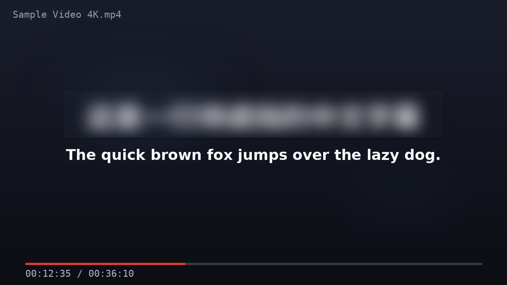

# 字幕遮挡条 Subtitle Cover

看中英双语字幕视频时, 用一条"实时磨砂玻璃"遮挡条盖住中文字幕行, 只看英文。
**系统级置顶(全屏视频也在其下)**, 实时高斯模糊, 纯 Linux + X11。

[English](README.md)



## 为什么做这个

看双语视频时忍不住瞟中文字幕, 听力练习就废了。浏览器扩展只在浏览器内有效;
Linux 桌面端此前没有任何同类工具 —— 现有的 [oh-subtitle][ohs]、
[subtitle-hider][sh] 都是 Windows 专用。本项目填补这个空白。

[ohs]: https://github.com/Surbowl/oh-subtitle
[sh]: https://github.com/Bennycopter/subtitle-hider

## 功能

- **永远置顶, 含全屏**: `override_redirect` X11 窗口, 压在一切普通窗口
  (含全屏播放器/浏览器)之上; 窗口栈变化时自动压回栈顶。
- **实时磨砂模糊**: 持续虚化遮挡条真正下方的画面, 画面变化一帧内
  (~66ms @15fps)跟上。模糊强度、色调颜色/透明度、磨砂噪点可调。
- **透视**: 按住鼠标中键遮挡条立即消失(直接解除映射, 零延迟),
  松开恢复 —— "先听再看"; `Ctrl+Alt+O` 可从键盘切换同一状态。
- **轮廓提示**: 遮挡条出现/恢复/切换预设时, 边缘显示数秒"蚂蚁线"
  轮廓 —— 纯色背景下也能一眼找到它。
- **空气墙**: 拖动/缩放/滚轮都不会把遮挡条拖出屏幕, 撞到屏幕边缘
  直接停住(老配置里的屏外坐标启动时自动治愈)。
- **拖拽手柄**: 边缘/角部直接拖拽调整大小, 中部拖动移动。
  拖动/调整期间遮挡条自动切换为**纯色实底 + 常亮轮廓**(暂停实时模糊
  与屏幕抓取), 不会看到延迟跟随的模糊; 释放瞬间恢复磨砂。
  滚轮调高度 / `Shift`+滚轮调宽度 / `Ctrl`+滚轮调模糊度。
- **快速笔记**: `Ctrl+Alt+N` 弹出便签, 每条笔记可附当前画面截图,
  Markdown 保存于 `~/.local/share/subtitle-cover/`。
- **锁定(鼠标穿透)**: 点击穿透到下层窗口, 遮挡条以 70% 透明度提示
  锁定状态; 用同一热键或 `Ctrl+Alt+C` 解锁(锁定时面板仍可呼出)。
- **锁屏感知**: 锁屏/挂起时暂停渲染, 解锁恢复。
- **面板永不被遮挡**: 右键或 `Ctrl+Alt+C` 打开控制面板, 遮挡条保持
  显示在面板正下方; 面板内列出全部热键(含注册失败标注)。
- **托盘图标**(装了 AppIndicator 时)。
- **状态全部记忆**: 位置/尺寸/颜色/模糊度/热键等。
- **轻量**: 纯 Python + GTK3 + Pillow。空闲 ~0-2% CPU(自动降频),
  播放中约占单核 4%, 内存 ~180-240MB。

## 环境要求

- **X11** 会话的 Linux (GNOME on Xorg / KDE X11 等)。不支持 Wayland
  (协议限制, 应用无法压在一切之上; Shell 扩展版在计划中)。
- Python 3 + PyGObject (GTK3) + Pillow
- python-xlib(缺失时自动使用项目随附的 `.deps/` 副本)

## 安装

```bash
git clone https://github.com/<you>/subtitle-cover.git
cd subtitle-cover
./install.sh            # 用户级安装, 无需 root; 加 --autostart 开机自启
./run.py                # 或从应用菜单启动
```

## 操作速查

| 操作 | 功能 |
| --- | --- |
| 左键拖动(中部) | 移动 |
| 拖动边缘/角部 | 调整大小 |
| 滚轮 / `Shift`+滚轮 / `Ctrl`+滚轮 | 高度 / 宽度 / 模糊强度 |
| 中键按住 | 透视: 遮挡条消失, 松开恢复 |
| 右键 | 控制面板 |
| `Ctrl+Alt+B` | 显示/隐藏 |
| `Ctrl+Alt+Shift+L` | 锁定/解锁(鼠标穿透) |
| `Ctrl+Alt+N` | 快速笔记 |
| `Ctrl+Alt+O` | 切换透视 |
| `Ctrl+Alt+P` | 循环切换位置预设 |
| `Ctrl+Alt+C` | 控制面板(锁定穿透时也能呼出) |


## 工作原理(简)

1. **置顶**: 遮挡条是 `override_redirect` 的 X11 窗口, 绕过窗口管理器,
   天然压在一切普通窗口(含全屏视频)之上。
2. **实时模糊源**: 合成器把每个窗口的像素保存在离屏重定向像素图中
   (恒为实时), 但**极少**把最终画面写回 root 快照(实测每秒约 0 次,
   抓 root 严重滞后)。因此程序定位遮挡条正下方的各窗口, 按层
   (自底向上)直接 `XGetImage` 抓取, 跳过纯透明覆盖层, 逐层拼合后
   高斯模糊(先降采样 4 倍的快速管线)再写回遮挡条 —— 全程无闪烁。
3. **线程架构**: 渲染在独立线程, 通过 ctypes 独占连接直调 libX11;
   主线程(GLib)持有 python-xlib 连接(非线程安全), 两者不共享。
   主线程每帧发布一份不可变快照, 渲染线程每帧只读一次快照引用 ——
   无锁、无共享可变状态。
4. **省电**: 抓取数据与上帧相同则跳过; 静止约 0.7 秒后探测频率
   自动降到 2fps; 任何交互(拖动/热键/几何变化)立即唤醒渲染线程
   (首响应 ~30ms)。

## 性能

i9-13980HX 笔记本实测(2560x1600, 200% 缩放, 视频播放中):

| 状态 | CPU(单核) |
| --- | --- |
| 空闲/视频暂停 | ~0-2% |
| 视频播放 | ~4% |
| 空闲后首次交互响应 | ~30ms |

内存约 180-240MB。老轻薄本预估 CPU 数字 2-3 倍 —— 相比开着浏览器
依然轻松。

## 已知限制

- 仅支持 X11 会话; Wayland 需 GNOME Shell 扩展方案(欢迎 PR)。
- 暂只适配单显示器。
- 极少数播放器若以"解除重定向"方式渲染全屏, 模糊源会退化为
  滞后的 root 快照(mutter 下罕见)。
- 热键可在 `~/.config/subtitle-cover/config.json` 修改; 被系统占用的键
  会在面板热键清单中标注"注册失败"。

## 同类项目

| 项目 | 平台 | 方式 |
| --- | --- | --- |
| [oh-subtitle][ohs] | Windows (WPF) | 纯色半透明遮罩 + 笔记 |
| [subtitle-hider][sh] | Windows (PySide6) | DWM 系统模糊 |
| [block-subs][bs] | 浏览器扩展 | 页面内色条 |
| [subtitle-shield][ss] | 油猴脚本 | 页面内字幕模糊/隐藏 |

桌面级、Linux、不依赖系统模糊 API 的实时磨砂 —— 就是本项目填的空白。

## 许可

[MIT](LICENSE)
